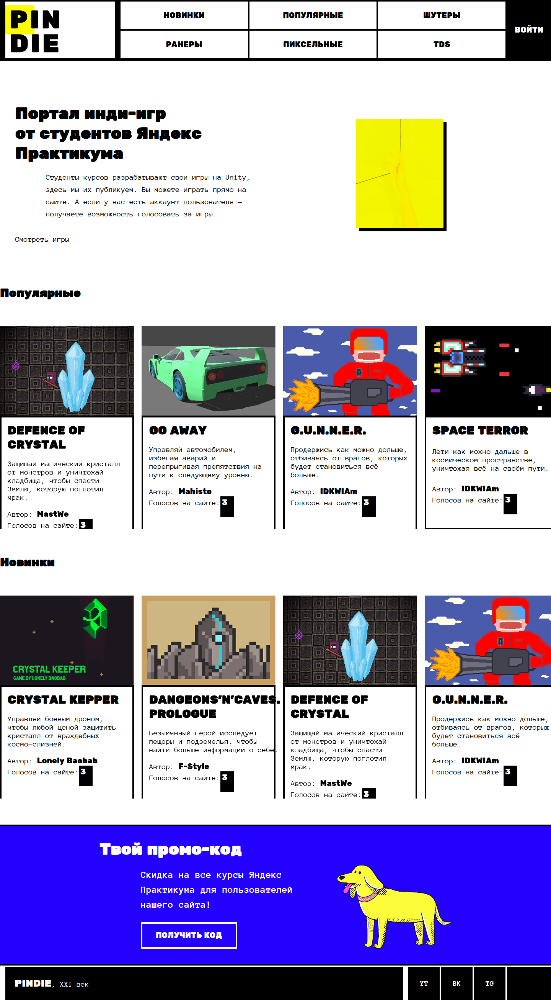

# Pindie

Pindie — учебный каталог инди-игр студентов Яндекс Практикума. На главной странице собраны подборки игр «Популярные» и «Новинки» с обложками, описаниями и именами авторов.



## О проекте

Проект выполнен в рамках обучения на курсах Яндекса. По интерфейсу это каталог небольших браузерных игр: посетитель может посмотреть подборки, открыть карточку игры и ознакомиться с описанием.

В репозитории есть главная страница, страницы тематических подборок, динамический маршрут игры, форма входа и интерфейс голосования. Для главной страницы используется локальный массив из семи записей. Категории, авторизация и данные страниц игр подключены к API на `localhost:3001`.

## Возможности

- Главная страница показывает локальные подборки «Популярные» и «Новинки».
- Карточки содержат обложку, название, описание, автора и число голосов из локального массива.
- Карточки ведут на маршрут `/games/[id]`; код страницы игры загружает информацию и саму игру через API.
- Кнопка «Получить код» показывает заданный в коде промокод на несколько секунд.
- В шапке открывается форма входа. Код формы отправляет данные в API и сохраняет полученный JWT в `localStorage`.
- На странице игры предусмотрена отправка голоса для авторизованного пользователя.

Пункты, зависящие от API, описывают предусмотренное поведение кода, но в текущем репозитории не могут быть проверены как работающие: backend отсутствует, а адрес API задан как `http://localhost:3001/api`.

## Технологии

| Технология | Использование в проекте |
| --- | --- |
| JavaScript, React 18 | Компоненты и клиентское состояние |
| Next.js 14, App Router | Страницы и маршруты приложения |
| CSS Modules и глобальный CSS | Стили страниц и компонентов, адаптивные правила |
| Zustand | Состояние авторизации на клиенте |
| Swiper | Слайдеры подборок на главной |
| Fetch API | Запросы к API каталога и авторизации |

## Локальный запуск

Требуется Node.js 18.17 или новее и npm. Проверка выполнялась на Node.js 20.20.2 и npm 10.8.2.

```bash
npm ci
npm run dev
```

Откройте `http://localhost:3000`. Команды из `package.json`:

| Команда | Назначение |
| --- | --- |
| `npm run dev` | Запустить сервер разработки Next.js |
| `npm run build` | Собрать production-версию |
| `npm start` | Запустить production-сборку после `npm run build` |
| `npm run lint` | Запустить `next lint` |

Переменные окружения проект не читает. Адрес API не вынесен в `.env`: он указан напрямую в `app/api/config.js` (`http://localhost:3001/api`). Для полноценной работы категорий, входа, голосования и страниц игр отдельно нужен совместимый API на этом адресе.

## Структура проекта

```text
app/
  api/                 запросы, адрес API и общие компоненты оболочки
  components/          шапка, карточки, подборки, форма входа и другие блоки
  data/                локальные демонстрационные игры и функции выборки
  games/[id]/          динамическая страница игры
  new/, popular/,      страницы подборок
  shooters/, runners/,
  pixel-games/, tds/
  Login/               отдельная страница входа
  layout.js            общий макет и метаданные
  globals.css          общие стили и адаптивные правила
public/                шрифты и иллюстрации
docs/                  снимки для README
```
